# Fix mobile balances and oracle action states

Valid seven-digit balances previously overflowed the phone statistics, and Trade $BEG was hidden. Phone statistics now use one column at the existing type size, while header actions wrap to keep Trade reachable. Invalid donations show a specific inline error and cannot appear approved. Close batch stays disabled until its read-only contract preflight succeeds, explains insufficient oracle funding, and rechecks changed state. Every write retains the existing simulation immediately before sending.

The focused source changes and regression tests live in `web/`; the rebuilt relative-URL production export is in `dist/`. Existing contracts, ABIs, wallet connector, transaction builder, dependency manifests/locks and build configuration are unchanged.

Validation: all four reports reproduced before editing; production build and typecheck pass; 12 focused tests and all eight simulated write flows pass. Regression cases cover 320/375/390/600/768/1440px, invalid amount recovery, pending/unfunded Close, budget changes, send-time rejection and late replies. The design probe passes 16/16. Revision Lighthouse mobile performance is 87; accessibility, best practices and SEO are 100. See [the revision validation record](revision/validation.md) and [reviewer responses](../.imd-responses.json). No transaction was broadcast. WebKit and physical wallet handoffs remain unverified.

## Regression screenshots

These images use the review's synthetic balance and wallet fixtures, never seeded into the app.

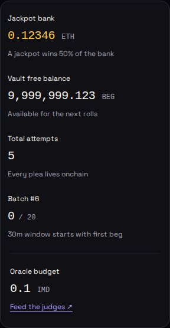

[375px statistics](revision/stats-375.jpg) · [390px first screen with Trade](revision/first-screen-390.jpg)

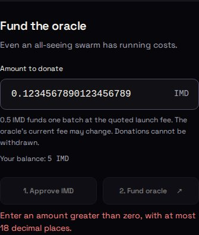

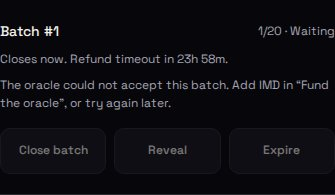

## First screen and complete page

Actual live RPC state, 390px wide. The Beg form and its action are on the first screen.

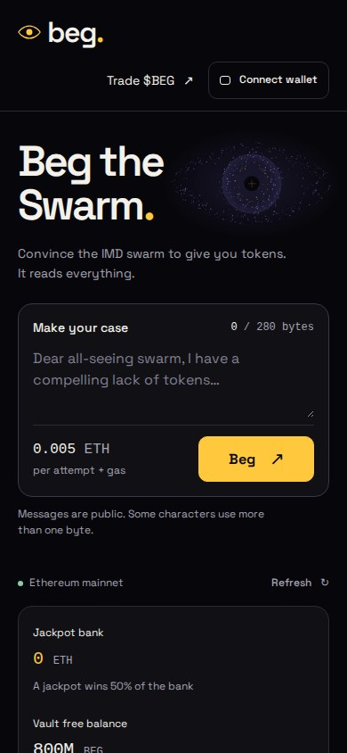

[Full desktop page](screenshots/desktop-full.jpg) · [Full mobile page](screenshots/mobile-full.jpg) · [Wallet sheet with visible keyboard focus](screenshots/wallet-mobile.jpg)

## Each section

### Hero and primary interaction

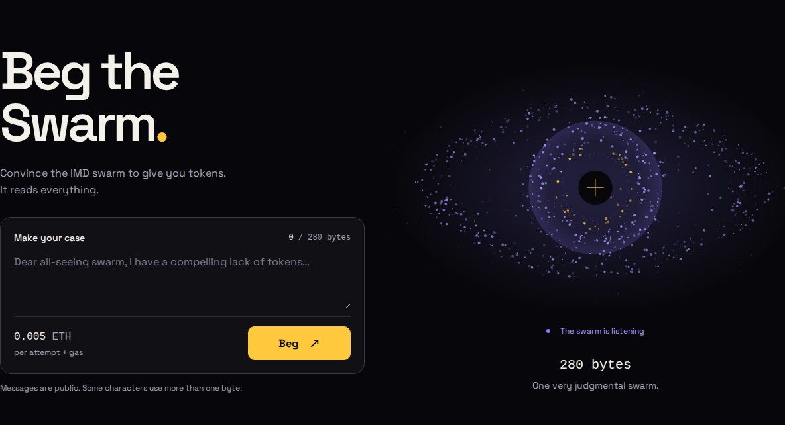

### Live statistics

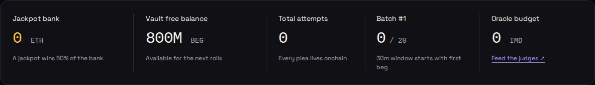

### Live feed

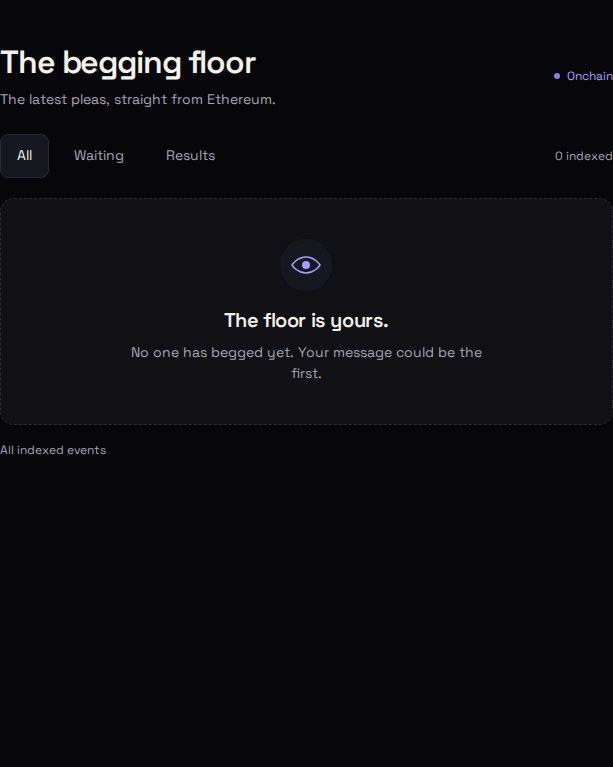

### Odds

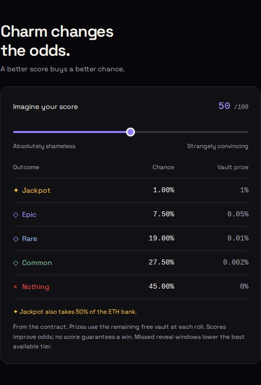

### Hall of fame

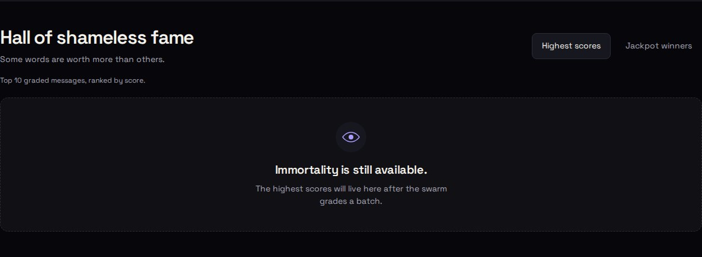

### My stuff

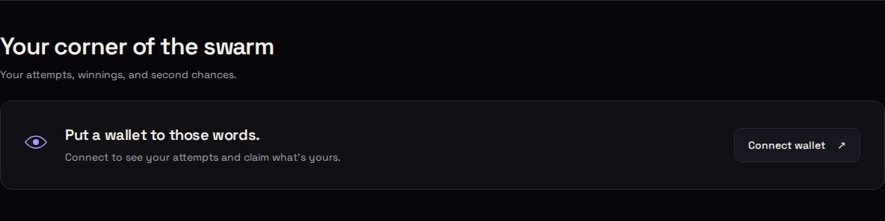

### Keeper actions and oracle funding

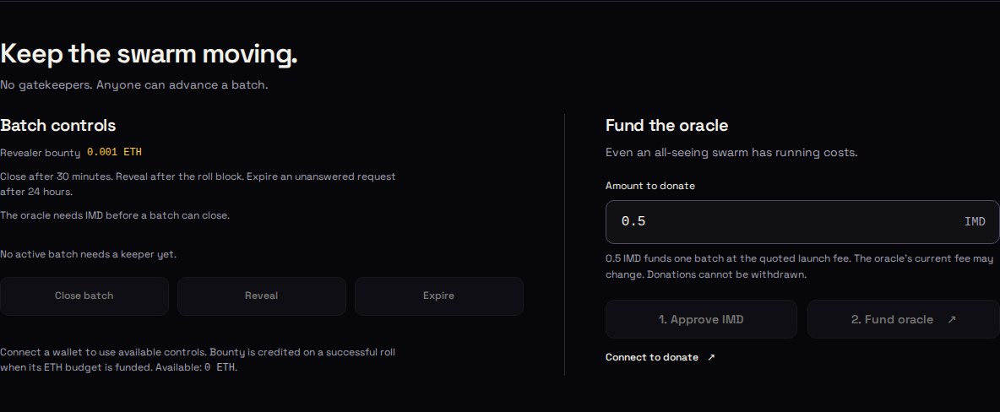

### How it works

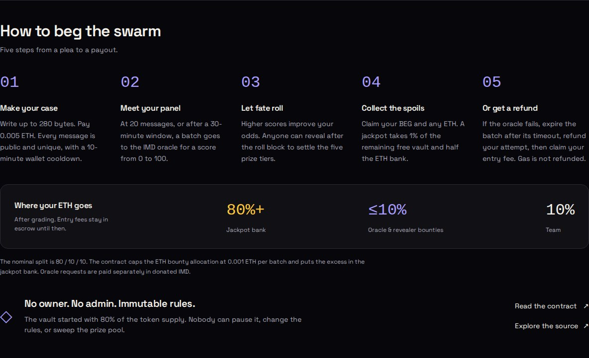

## Populated interaction fixture

[Populated fixture screenshot](screenshots/fixture-desktop.jpg) shows synthetic messages for waiting, pending, graded, expired and jackpot states, including literal hostile HTML to verify safe text rendering. It is explicitly a test fixture. These entries and balances are not seeded into the app; every other screenshot above uses actual live RPC responses.
